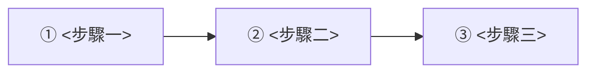

# 單元教案骨架

`講義/NN_主題.md` 一律照這個骨架寫。章節順序與時間盒來自課程大綱的「每個 Section 的時間配置」，
**不要自行增刪時間盒或改動時數**。每個章節要寫到多完整，見 [writing-guide.md](writing-guide.md)。

- 開頭是 **YAML front matter**，**不寫 `#` H1**。book-creator-skill 編書時靠 front matter 取章號與標題，
  而且規定內文不得有 H1；`md-to-pdf.js` 出單元 PDF 時會自動把 front matter 換成 H1 標題與資訊列。
- 每個 `##` 在 PDF 裡會自動分頁（第一個 `##` 除外），`###` 不分頁，用來在章節內分小節。
- 圖號格式 `圖 NN-k`，表示第 NN 單元第 k 張圖（Mermaid 與擷圖共用一組流水號）。

---

## 骨架（複製這段開始寫）

````markdown
---
session: NN
title: <主題，和檔名 NN_ 後面那段一致>
subtitle: <大綱「教學與實作內容」的關鍵字，用頓號串起來>
duration: 2 小時（120 分鐘）
outcome: <直接抄大綱「單元驗收成果」該格原句>
example: 範例/NN_<主題>
---

## 學習目標

上完這個單元，你能夠：

- <動詞開頭、可當場驗證的能力：「用 `VECTOR_DISTANCE` 查出與問題最接近的 5 個片段」>
- <能力二：寫到「做到什麼程度」，不要只寫「了解 ○○」>
- <能力三>

## 先備知識

- <前一單元的具體產出：「`範例/05_…/RagDemo` 可 `dotnet build`，且 `Chunks` 表有資料」>
- <大綱「學員先備能力」裡跟本單元相關的項目>
- <本單元會用到、但不在本單元教的工具或指令>

## 觀念說明（20 分鐘）

### 為什麼需要 <主題>

<沒有它會發生什麼具體問題；最好舉一個會真的發生的錯誤或錯誤結果。>

### <主題> 怎麼運作

<引導句：下圖要回答什麼問題、看的時候注意哪裡。>



*圖 NN-1　<圖的標題>*

| 編號 | 做了什麼 | 對應程式碼／為什麼 |
|---|---|---|
| ① | <這一步的輸入、處理、輸出> | `<類別.方法>` 或 `<檔案路徑>` |
| ② | | |
| ③ | | |

### 限制與注意事項

- <硬性限制：維度、長度上限、版本需求、權限>
- <不適用的情境，以及那時該怎麼做>

### 名詞對照

| 名詞 | 白話說明 | 在本課程中是 |
|---|---|---|
| <技術名詞> | <一句話，不要抄官方文件> | <具體的類別／資料表／設定鍵> |

## 教師示範（25 分鐘）

<一段話說明示範的情境與要證明的事：「上傳一份 PDF，看它跑到 Embedding 階段，證明每個片段都寫入了 768 維向量」。>

### 示範步驟

1. <教師做的第一個動作，寫到可以照做：點哪個按鈕、輸入什麼>
2. <第二個動作>


*圖 NN-2　<畫面標題>*

畫面重點：

1. **①<畫面上的位置>**：<顯示的是什麼、數值從哪裡來>
2. **②<位置二>**：<點下去會發生什麼>

### 程式碼走讀

<示範背後的關鍵程式。純後端單元沒有 UI 時，這一小節就是示範的主體，要附執行結果。>

```csharp
// 範例/NN_<主題>/<專案>/<路徑>/<檔名>.cs
<整個方法或整個小類別，關鍵行加 // ① // ② 標號>
```

程式說明：

| 標號 | 做了什麼 | 為什麼這樣寫 |
|---|---|---|
| ① | | |
| ② | | |

執行結果：

```text
<貼關鍵幾行輸出或日誌>
```

## 學員實作（65 分鐘）

範例專案：`範例/NN_<主題>/`（從 `範例/<前一單元>/` 複製後往上加）

### 步驟一　<做什麼>（<分鐘數> 分鐘）

**目的**：<這一步完成後，系統多了什麼能力。>

```bash
# 在 workspace 根目錄執行
<可以直接貼上執行的指令>
```

```csharp
// 範例/NN_<主題>/<專案>/<路徑>/<檔名>.cs
<最小完整單位：整個方法或整個類別，關鍵行加 // ① // ② 標號>
```

程式說明：

| 標號 | 做了什麼 | 為什麼這樣寫 |
|---|---|---|
| ① | | |
| ② | | |

**預期結果**：<執行後會看到的具體輸出／畫面／資料列，讓學員自己能判斷對不對。>

```text
<預期輸出的關鍵幾行>
```

> 常見改錯：<這一步最容易寫錯的地方與後果>（沒有就刪掉這行）

### 步驟二　<做什麼>（<分鐘數> 分鐘）

<同上：目的 → 指令 → 程式碼 → 程式說明 → 預期結果 → 常見改錯>

### 檢查點

做到這裡，你應該可以：

- [ ] <可觀察的結果一：「首頁顯示 `SQL Server：已連線（17.0）`」>
- [ ] <結果二>

## 常見錯誤

| 症狀（錯誤訊息原文） | 原因 | 處理 |
|---|---|---|
| <學員實際會看到的訊息，照原文貼> | <為什麼會發生> | <具體的修法：改哪個檔案、哪個設定> |

## 單元驗收（10 分鐘）

**驗收標準**：<抄大綱「單元驗收成果」該格原句>

驗收方式：

1. <怎麼證明做到了：執行什麼、看哪裡、應該看到什麼值>
2. <第二個觀察點>
3. <反向驗證：故意做錯一件事，系統要明確失敗而不是默默出錯>

## 延伸閱讀

- [<文件標題>](<官方文件網址>) —— <一句話說明讀了能解決什麼問題>
````

---

## 章節取捨

- 「教師示範」沒有 UI 可示範時，改成「程式碼走讀＋執行結果」，**不要刪掉這個時間盒**。
- 「常見錯誤」寫不出真實錯誤就留空並註明「本單元尚無回報案例」，不要編造。
- 「延伸閱讀」沒有可靠來源就整段拿掉，不要放沒查證過的連結。
- 學員實作的步驟數依內容決定，通常 3～5 步；每步都要有「預期結果」。

## 篇幅

一個 2 小時單元，PDF **10～18 頁**。說明完整比頁數少重要：
**內容溢出時拆成更多 `###` 小節或把一張大圖拆成兩張，不要刪說明、不要把程式說明挪進註解。**
超過 18 頁才表示內容超出一個單元能教完的量，這時回頭對照大綱，把不在大綱裡的延伸內容拿掉。

## 對齊大綱

大綱「教學與實作內容」那一格的**每一項**都要落到某個章節（最好就是某個 `###` 的標題）。
寫完回頭核對一次，漏掉的就是答應了學員卻沒教。
