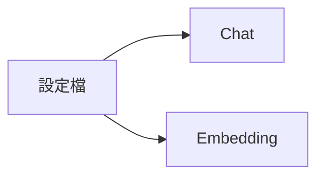
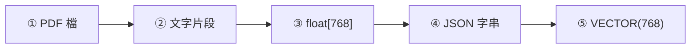

# 寫作規格：內容、圖解、程式碼

這份文件規定教案**每一段要寫到什麼程度**。[lesson-plan-template.md](lesson-plan-template.md) 管「有哪些章節」，
這份管「每個章節裡的東西要完整到哪裡」。寫完一個單元後，用文末的〈自我檢核〉逐條對照。

總原則：**學員只拿著這份 PDF 和範例專案，沒有老師在旁邊，也要能看懂、做得出來、知道自己做對了沒。**
任何一段讀完會讓學員問「然後呢？」「這行在幹嘛？」「我怎麼知道成功了？」，就是沒寫完。

> 下面的「✓ 合格」範例是**示範格式**用的，類別名、方法名、數字是舉例，不一定和
> `範例/06_…` 的實際程式一致。實際寫教案時，名稱與程式碼一律從當單元的範例專案複製。

---

## 一、內容描述：精準、可驗證

### 1. 每個觀念都要回答四個問題

| 問題 | 要寫出來的內容 | 缺了會怎樣 |
|---|---|---|
| **是什麼** | 一句白話定義 + 本課程裡它具體是哪個東西（類別名、資料表名、端點、設定鍵） | 學員知道名詞，不知道在專案哪裡 |
| **為什麼需要** | 沒有它會發生什麼具體問題（最好是會發生的錯誤或錯誤結果） | 學員覺得是多餘步驟，實作時跳過 |
| **怎麼運作** | 依序的步驟或資料流，搭一張圖 | 只會照抄，換個情境就不會 |
| **邊界與限制** | 什麼情況不適用、有什麼硬性限制（維度、長度、版本、權限） | 上線後才踩雷 |

### 2. 用具體值取代模糊詞

| ✗ 模糊 | ✓ 精準 |
|---|---|
| 設定相關參數 | 在 `appsettings.json` 的 `Embedding:ExpectedDimensions` 填 `768` |
| 呼叫 API 取得結果 | `POST http://localhost:11434/api/embed`，body 為 `{"model":"embeddinggemma","input":["…"]}` |
| 速度會比較快 | 16 筆一批送出，來回次數從 N 次降為 ⌈N/16⌉ 次 |
| 可能會出錯 | 維度不符時丟出 `InvalidOperationException`，工作狀態進入 `Failed` |
| 等等、之類、相關的 | 把項目全部列出來；列不完就寫「共 N 項，完整清單見 `路徑`」 |

規則：

- **有名字就寫名字**：類別、方法、資料表、欄位、設定鍵、端點、指令、檔案路徑，全部用 `行內程式碼` 寫出全名。
- **有數字就寫數字**：埠號、維度、批次大小、逾時秒數、版本號、預期筆數。
- **有結果就寫結果**：「執行後會看到 `Build succeeded. 0 Warning(s) 0 Error(s)`」，而不是「確認建置成功」。
- **因果要寫完整**：「因為 A，所以 B；如果不這樣做，會 C」。只寫 B 的規則學員記不住。
- **不寫沒查證的事**：官方文件沒寫的數字（例如某模型的維度）要寫「用程式量測」，不要猜。

### 3. 名詞第一次出現就解釋

第一次出現的技術名詞，同一句或下一句給白話解釋，並列入「名詞對照」表。之後直接使用，不重複解釋。

---

## 二、圖解：圖不能孤立出現

每一張 Mermaid 圖（以及每一張擷圖）都由**四個部分**組成，缺一不可：

```
① 引導句   —— 這張圖要回答什麼問題、看的時候注意哪裡
② 圖本身   —— ```mermaid 區塊或 
③ 圖說     —— 緊接在圖下方、單獨一行：*圖 NN-k　標題*
④ 圖解說明 —— 逐節點（或逐箭頭）編號說明，對應到程式碼位置
```

### ✗ 不合格（只有圖）

````markdown
所以設定檔要分成兩區：



**最重要的一條規則**……
````

學員看完不知道「兩區」在設定檔裡長什麼樣、B 和 C 各被誰讀取、分開的好處是什麼。

### ✓ 合格（四個部分齊全）

````markdown
下圖說明一份文件從上傳到寫進資料庫，中間經過哪幾個元件。看的時候注意：
**每個箭頭都是一次資料格式轉換**，錯誤最常發生在轉換點上。



*圖 06-1　文件片段向量化的資料格式轉換*

| 編號 | 格式 | 負責元件 | 說明 |
|---|---|---|---|
| ① → ② | 二進位 PDF → `string` | `PdfTextExtractor`（Section 05） | 擷取文字後依 800 字切片 |
| ② → ③ | `string` → `float[]` | `OllamaEmbeddingService.EmbedAsync` | 呼叫 `/api/embed`，並驗證長度必須是 768 |
| ③ → ④ | `float[]` → `"[0.01,-0.02,…]"` | `SqlEmbeddingRepository.ToJsonArray` | 用 `InvariantCulture`，避免小數點變逗號 |
| ④ → ⑤ | JSON → 二進位向量 | SQL Server `CAST(... AS VECTOR(768))` | 維度寫死在 SQL，和欄位宣告一致 |
````

### 圖解說明的寫法

- 節點文字前加 `①②③` 編號，說明表用同一組編號對應，學員能在圖和文字之間來回對照。
- 說明表至少三欄：**編號、做了什麼、對應的程式碼位置（類別.方法 或 檔案路徑）**。
  純概念圖沒有程式碼可對應時，第三欄改寫「為什麼要這一步」。
- 流程有分支（判斷、失敗路徑）時，**每一條分支都要說明**觸發條件與結果，不能只講成功路徑。
- `sequenceDiagram` 改成逐訊息說明：「第 3 步 `API->>DB` 送出的是什麼、回來的是什麼」。
- 擷圖的圖解說明就是「操作重點」清單：用 ①②③ 對應畫面上的位置（「右上角的『上傳』按鈕」），
  說明點下去會發生什麼。

### 選對圖型

| 要表達的東西 | 用什麼 | 大小限制（實測） |
|---|---|---|
| 資料或處理的先後順序 | `flowchart LR` | 4～6 個節點，高約 100 px |
| 有判斷分支的流程 | `flowchart TD` + 菱形 `{"條件？"}` | 不超過 8 個節點，量過再放 |
| 誰呼叫誰、請求與回應 | `sequenceDiagram` | 3～4 個參與者、8 則訊息內 |
| 狀態的變化 | `stateDiagram-v2` | 5～6 個狀態 |
| 資料表關係 | 3 張以內用 `erDiagram`；更多改 `flowchart LR` | 5 個實體的 ER 圖實測 685 px |

**一張圖講一件事。** 要講的東西太多就拆成兩張圖各自配說明，不要塞成一張高過一頁（約 979 px）的大圖
—— `.mermaid` 不跨頁，太高會整張推到下一頁並留下大片空白。

### Mermaid 語法規定

- **中文節點文字一律用雙引號包起來**：`A["使用者提問"]`。不包的話，中文標點會讓解析失敗，
  `md-to-pdf.js` 只警告不中斷，你會拿到一份缺圖的 PDF。
- 換行用 `<br/>`：`B["JSON 字串<br/>[0.01,-0.02,…]"]`。
- 不要寫 `%%{init}%%`，配色由 `md-to-pdf.js` 統一注入。
- 跨 subgraph 的連線會讓 `direction` 失效、整張攤寬。需要表達兩張圖的關係，用一句文字說明。

---

## 三、程式碼：貼完整、逐段講

每一個程式碼區塊都由**五個部分**組成：

```
① 引導句   —— 這段程式在解決什麼問題、放在哪個檔案、被誰呼叫
② 程式碼   —— 第一行註解寫檔案路徑；貼到「能獨立看懂」的最小完整單位
③ 程式說明 —— 逐段對應：這幾行做什麼、為什麼這樣寫
④ 預期結果 —— 執行後會看到什麼（輸出、畫面、資料庫內容）
⑤ 常見改錯 —— 這段最容易寫錯的地方（沒有就省略）
```

### 貼多少：最小完整單位

- **方法就貼整個方法**（簽章到結尾大括號），類別很短就貼整個類別。
  學員要看得到參數從哪來、回傳什麼。
- **不要用 `/* ... */` 或 `// ...` 省略會影響理解的邏輯**。真的太長（超過約 40 行）時，
  拆成兩個區塊分別說明；省略的是樣板碼（using、建構子注入）才可以省，並寫明
  `// （省略：建構子注入 _http 與 _options，完整內容見 範例/06_…/Services/OllamaEmbeddingService.cs）`。
- **第一行一定是檔案路徑註解**：`// 範例/06_Embedding與SQL向量儲存/RagDemo/Services/OllamaEmbeddingService.cs`
  （SQL 用 `--`、JSON 無法註解就在引導句寫路徑）。
- **程式碼必須和範例專案裡的一致**。先寫範例、`dotnet build` 過，再從範例檔複製進教案，不要憑印象重打。
- 關鍵行加**行尾註解**，用 `// ①` `// ②` 標號，下面的程式說明用同一組編號對應。

### ✗ 不合格（片段 + 一句話）

````markdown
**分批**：一次送 16 筆，不要一筆一次來回：

```csharp
foreach (var batch in Batch(pending, _options.BatchSize)) { /* ... */ }
```
````

學員不知道 `Batch` 從哪來、`pending` 是什麼、迴圈裡要做什麼。

### ✓ 合格（五個部分齊全）

````markdown
`EmbedAllAsync` 是背景工作在 `Embedding` 階段呼叫的入口：收到一份文件的所有片段，
先查快取，沒算過的再分批送給 Ollama。它在
`Services/OllamaEmbeddingService.cs`，由 `DocumentPipelineWorker` 呼叫。

```csharp
// 範例/06_Embedding與SQL向量儲存/RagDemo/Services/OllamaEmbeddingService.cs
public async Task<IReadOnlyList<float[]>> EmbedAllAsync(
    IReadOnlyList<string> texts, CancellationToken ct)
{
    var results = new float[texts.Count][];
    var pending = new List<int>();                          // ① 還沒算過的片段索引

    for (var i = 0; i < texts.Count; i++)
    {
        if (_cache.TryGetValue(texts[i], out var hit)) results[i] = hit;   // ② 命中快取
        else pending.Add(i);
    }

    foreach (var batch in pending.Chunk(_options.BatchSize))           // ③ 16 筆一批
    {
        var inputs  = batch.Select(i => texts[i]).ToList();
        var vectors = await CallEmbedApiAsync(inputs, ct);              // ④ 一次來回
        for (var k = 0; k < batch.Length; k++)
        {
            results[batch[k]] = vectors[k];                             // ⑤ 放回原位置
            _cache[texts[batch[k]]] = vectors[k];
        }
    }
    return results;
}
```

程式說明：

| 標號 | 做了什麼 | 為什麼這樣寫 |
|---|---|---|
| ① | 用 `pending` 記住**索引**而不是文字 | 回傳順序必須和輸入一致，記索引才能放回原位 |
| ② | 片段文字完全相同就直接取快取 | 同一份文件的頁首、免責聲明常重複出現，不必重算 |
| ③ | `Chunk()`（.NET 6+ 內建）把索引切成每 16 個一組 | 批次大小來自 `Embedding:BatchSize`，不寫死 |
| ④ | `CallEmbedApiAsync` 送出一批並**驗證維度與筆數**（見步驟三） | 一次 HTTP 來回處理 16 筆，減少網路延遲 |
| ⑤ | 用 `batch[k]` 把向量寫回原索引，同時存快取 | 若寫成 `results[k]` 會錯位，而且不會報錯 |

預期結果：上傳一份 40 個片段的 PDF，日誌出現 3 行 `POST /api/embed (16 筆)`、`(16 筆)`、`(8 筆)`；
同一份再上傳一次，日誌出現 `快取命中 40/40`，不再呼叫 API。

> 常見改錯：⑤ 寫成 `results[k] = vectors[k]` —— 第二批開始向量全部錯位，
> 檢索結果變得很怪但程式不會報錯。
````

### 指令區塊

- 標明**在哪個目錄執行**（`# 在 workspace 根目錄執行`），並給出可以直接貼上的完整指令。
- 下面緊接**預期輸出**（用 ```text 區塊，貼關鍵幾行即可），讓學員比對。
- Windows 上 PowerShell 與 Git Bash 語法不同時（背景執行、環境變數），兩種都寫。

### 設定檔區塊（JSON / appsettings）

- 引導句寫檔案路徑與「放在哪一層節點底下」。
- 每個鍵都要說明：用途、單位、合法值、改錯的後果。用表格：

  | 鍵 | 值 | 說明 |
  |---|---|---|
  | `ExpectedDimensions` | `768` | 必須等於資料表 `VECTOR(768)` 的維度；不符時工作進入 `Failed` |

- 金鑰與連線字串一律寫佔位值，並註明「請填入自己的 ○○」。

### SQL 區塊

- 註明在哪個資料庫執行、是否可重複執行（冪等）。
- 查詢要附**預期結果**（欄位名與一兩列範例值），讓學員知道自己查到的是不是對的。

---

## 四、自我檢核（寫完每個單元都跑一次）

內容：

- [ ] 大綱「教學與實作內容」的每一項都落到某個章節，且在該章節以 `###` 或粗體可被找到
- [ ] 每個觀念都回答了「是什麼／為什麼／怎麼運作／邊界」
- [ ] 全文搜尋「等等」「之類」「相關」「適當」「一些」，逐一改成具體內容
- [ ] 每個實作步驟最後都有「預期結果」，學員能自己判斷對不對

圖解：

- [ ] 每張 Mermaid 圖和擷圖前有引導句、下方緊接 `*圖 NN-k　…*` 圖說
- [ ] 每張圖後有逐節點（或逐位置）的編號說明表／清單
- [ ] 圖號連續（`圖 06-1`、`06-2`…），文中引用圖時寫圖號

程式碼：

- [ ] 每個 ```csharp／```sql 區塊第一行是檔案路徑註解
- [ ] 沒有省略關鍵邏輯的 `/* ... */`
- [ ] 每個區塊後有「程式說明」（標號表或編號清單）與「預期結果」
- [ ] 教案裡的程式碼和 `範例/NN_主題/` 的實際檔案一致（抽查 2～3 段）

可以用 grep 粗篩（在 workspace 根目錄執行）：

```bash
F="講義/NN_主題.md"
echo "Mermaid 圖：$(grep -c '^```mermaid' "$F")　圖說：$(grep -cE '^\*圖 [0-9]+-[0-9]+' "$F")"
echo "程式碼區塊：$(grep -cE '^```(csharp|sql|cshtml|razor|js)' "$F")　程式說明：$(grep -c '程式說明' "$F")"
grep -nE '/\* *\.\.\. *\*/|// *\.\.\.$|等等|之類' "$F"
```

Mermaid 圖數加擷圖數應等於圖說數；程式碼區塊數與程式說明數不必相等（兩三行的小片段可以用一句話講完），
但差距過大就是有區塊沒講解。
